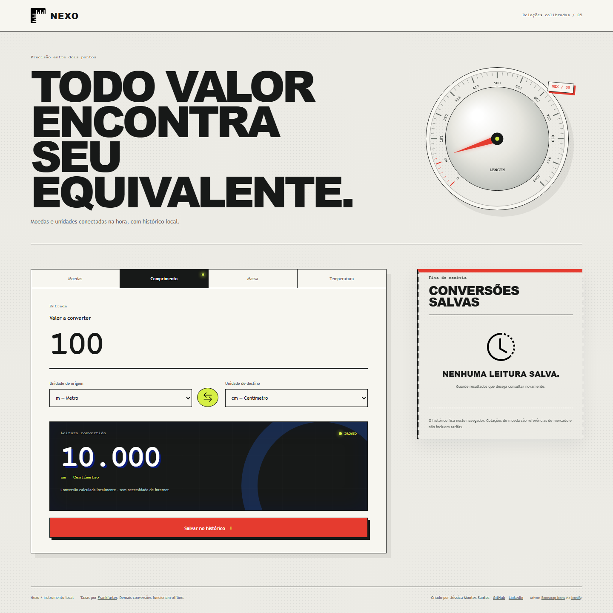

# Nexo — conversor de moedas e unidades

Abra `index.html`. Comprimento, massa e temperatura funcionam offline; moedas requerem internet.

## Funcionalidades
- Quatro categorias: moedas (BRL, USD, EUR, GBP, JPY, CAD), comprimento, massa, temperatura.
- Conversões locais usando fatores precisos e fórmulas de temperatura.
- Câmbio por API Frankfurter v2, sem chave; data da taxa e erro de rede exibidos claramente.
- Inverter origem/destino e armazenar até 12 conversões no histórico (`localStorage`).

## Fonte
https://frankfurter.dev/ — rota `/v2/rate/{base}/{quote}`.

As taxas são referências de mercado, normalmente atualizadas diariamente; não incluem IOF, spreads, taxas bancárias e outros encargos. Não são cotações negociáveis em tempo real.
